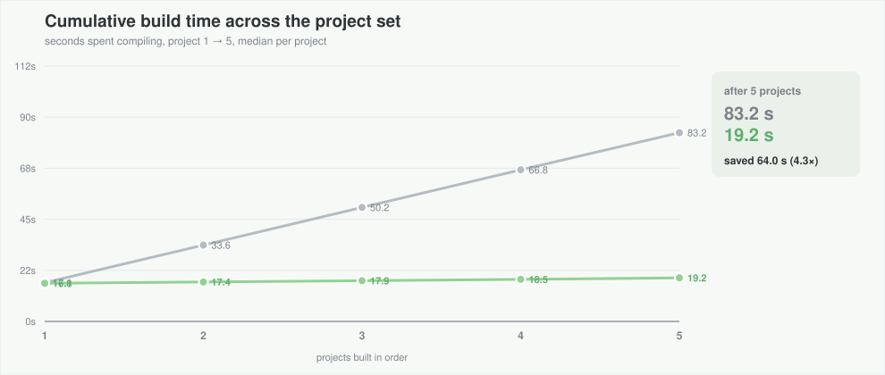
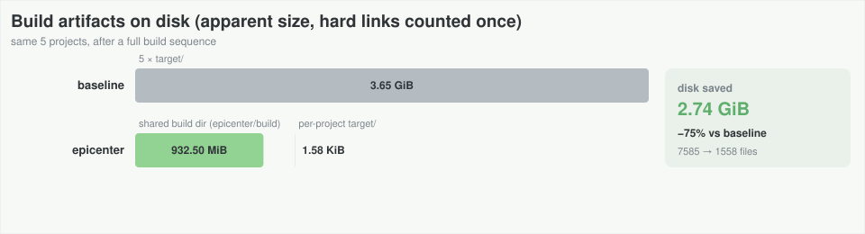
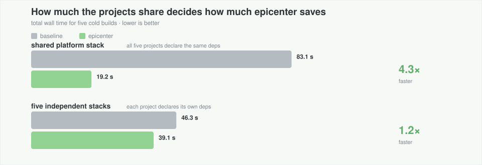
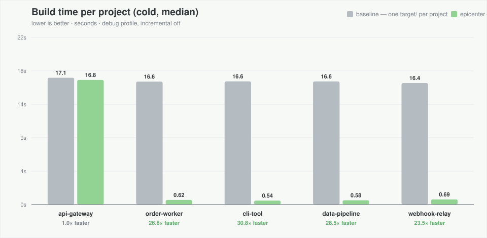
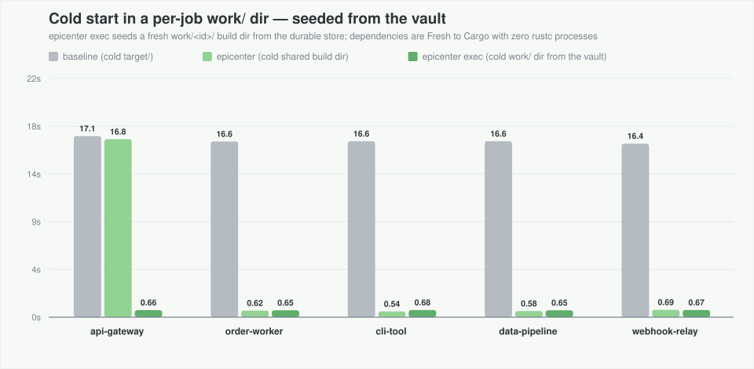

<h1 align="center">
    
    <br>
    <b>epicenter</b>
    <br>
    <sub>
        <sup>The state layer for Cargo builds</sup>
    </sub>
</h1>

<p align="center">
    <a href="https://crates.io/crates/epicenter-cli"></a>
    <a href="https://crates.io/crates/epicenter-cli"></a>
    <a href="https://docs.rs/epicenter-cli"></a>
    <a href="https://github.com/TheAnalist/epicenter/blob/main/LICENSE"></a>
    <a href="https://github.com/rust-lang/rfcs/blob/master/text/2495-min-rust-version.md" title="MSRV"></a>
</p>
<br>

Rust has two main problems: slow compilation times and big target directories.
This usually means that every Cargo project compiles its dependencies into its own `target/` directory:
ten projects = ten copies of the same rlibs, consuming gigabytes of storage.
So *epicenter* tries to solve this problem with a simple idea:
why not keep one shared version of compiled dependencies?

It manages that state as **three tiers, one tool**:

- **store** - a durable vault of unit groups addressed by Cargo's own
  fingerprint hashes (`…/epicenter/store/…`); survives `cargo clean`, feeds
  cold starts and parallel jobs.
- **build** - the shared cache every project compiles into
  (`…/epicenter/build/…`): dependency rlibs, incremental state, build-script
  outputs - the heavy 95% - compiled once and reused everywhere.
- **work** - disposable per-job build dirs seeded from the vault
  (`…/epicenter/work/<id>/`), where CI jobs and agents run fully parallel:
  nothing shared but the read-only vault.

Around those tiers *epicenter* owns the lifecycle: **configure** (`setup`,
`doctor` - cross-OS config truth), **observe** (`status`, including
`--units`/`--unit`, and `store vault`/`store verify`), **reclaim**
(`store prune` for age-based housekeeping, tiered `store evict` for deliberate
removals with honest freed-vs-released accounting), **persist**
(`store harvest`/`store restore`) and **execute** (`exec`). Cargo stays Cargo -
no shim, no daemon - and a rustc-wrapper (kache or sccache) remains an optional
tier.

One configuration for Linux, WSL, macOS and native Windows: the platform code
is std-only and cfg-gated, and the canonical template line is identical
everywhere. (Linux/WSL and Windows are verified live; Apple and BSD targets are
compile-verified - see Cross-OS notes for the first-run checklist.)

*epicenter isn't a Cargo wrapper* - it leans on Cargo's own fingerprint engine,
which decides freshness and therefore recompilation. A unit restored from the
vault is `Fresh` to Cargo in milliseconds, with **zero `rustc` processes
spawned**.

## Benchmarks

These benchmarks are done against 5 projects with 37 identical dependencies each.

**Five cold builds: 123 s → 28.9 s (4.3× faster). Disk: 3.65 GiB → 0.91 GiB
(−75%). A cold per-job `work/` dir seeded from the vault: 1.50 s.**

All five projects declare the same platform stack. This is the monorepo / "one platform crate" case.
Every non-local Cargo unit is byte-for-byte identical across projects,
so epicenter can compile it once and the other projects reuse it.

### What is measured

| | baseline | epicenter |
|---|---|---|
| config | no `build-dir` key | `epicenter setup` → `[build] build-dir = '{cargo-cache-home}/epicenter/build'` |
| where dependencies compile | `<project>/target/` (one copy each) | one shared build dir |
| measurement | wall clock around `cargo build --locked --offline` | same |
| reset before every run | `rm -rf` every `target/` | `rm -rf` every `target/` + the whole `epicenter/` cache |

In addition it measures the vault tier (`epicenter store harvest` + `epicenter exec`),
where a cold per-job build dir is seeded from the durable store instead of recompiling.











## Quickstart

```bash
cargo install epicenter-cli
epicenter setup                  # write the shared-cache config (backs up files it touches)
cargo build                      # any project of yours - intermediates now land in the shared cache
epicenter status                 # watch it fill up
epicenter doctor                 # verify everything is healthy
```

Every setup edit backs up the previous config as `config.toml.epicenter-bak[.N]` (monotonic suffixes).
`epicenter setup --revert` restores the newest Cargo config, and the global
`epicenter.toml` backup when present, atomically.

## Three workflows, one tool

1. **Daily development (zero extra steps)** - run `epicenter setup` once. Every
   project on the machine immediately shares compiled dependencies.
2. **Survive `cargo clean` and cold starts (the vault)** - `epicenter store harvest`
   snapshots built units into the read-only vault; `epicenter store restore` links
   them back so Cargo skips compilation completely.
3. **Parallel agents & CI jobs (zero lock waits)** -
   `epicenter exec --id agent-1 --target-dir -- cargo test` seeds a private
   per-job build dir from the vault in milliseconds - scoped to the package
   names in this project's `Cargo.lock`, not every package in the cache. Ten
   agents can build the same repo at the same time without waiting on Cargo's
   build-dir lock or duplicating rlibs on disk.

> **Recommendation for parallel agents on the same machine: use
> `epicenter exec` per job.** Do not point several concurrent jobs at one
> writable `build/` directory: Cargo's build-dir lock serializes them. `exec`
> gives each job its own build dir (and, with `--target-dir`, its own finals
> dir) seeded from the read-only vault, so the jobs do not contend.
> The shared build dir stays the warm cache for normal sequential local builds.
> For multiple machines, share the read-only vault and keep a local per-job
> build dir; do not share a writable build dir.

## Commands

Top level is intentionally small: `setup`, `status`, `doctor`, `exec`.
Advanced maintenance lives under `store`; the old top-level names remain as
hidden aliases for one release.

| command | what it does |
|---|---|
| `epicenter setup` | apply a preset + linker + wrapper to the **global** config; backs up every file it changes |
| `epicenter setup --preset auto\|dev\|ci [--write-profile] [--dev-debug full\|line\|none] [--measure]` | one intent: auto (CI-aware), local dev loop, or cold CI; `--write-profile` explicitly writes recommended Cargo profile values; `--measure` runs one calibration build |
| `epicenter setup --linker auto\|system\|lld\|wild\|mold\|gold` | linker policy; `auto` keeps what is configured; choose lld/wild/mold/gold explicitly; mold/gold require Linux + clang |
| `epicenter setup --wrapper kache\|sccache\|none` | external compile cache; epicenter never wraps rustc itself |
| `epicenter setup --cache-root PATH` / `--use-default` | choose or reset the shared build dir |
| `epicenter setup --work-root PATH` | choose the local per-VM job-dir root; same as the global-only `work` key |
| `epicenter setup --memory SIZE` / `--memory-budget` | memory budget for the 2 GiB/job cap (e.g. `16GiB`); same as `memory` in `epicenter.toml` |
| `epicenter setup --dry-run` | print the effective policy and exact config diff; write nothing |
| `epicenter setup --revert` | restore the newest Cargo + global `epicenter.toml` backups |
| `epicenter status [--json] [--units [--filter Q]] [--unit NAME]` | cache sizes; `--units` (optional filter) is the old `who`, `--unit` is the old `why` |
| `epicenter doctor [--json]` | profile audit (jobs/CGU/LTO/debug/split-debuginfo, last build/RSS), config/wrapper/filesystem/toolchain/mtime/store health, nightly hints |
| `epicenter exec ... -- <cmd>` | fresh per-job build dir seeded from the vault; child build/target dirs are env-pinned |
| `epicenter store vault\|verify\|prune\|evict\|harvest\|restore\|overlap` | advanced maintenance; same flags as before; `overlap` reports package/profile variants |

The old top-level `prune`, `evict`, `harvest`, `restore`, `vault`, `verify`,
`who`, and `why` still parse as hidden aliases for one release.

`status --json` is the machine-readable summary; `--units` and `--unit` are
the human forensics views.

### Presets: `auto`, `dev`, `ci`

A preset is one intent, not a bundle of compiler flags. It sets **jobs and
incremental**. Compiler knobs (debug, LTO, codegen-units) stay in your Cargo
profile; epicenter reports them, and only writes with the explicit `setup --write-profile`.

| preset | for | `setup` writes to Cargo config | `exec` |
|---|---|---|---|
| `auto` (default) | plug and play | `build.jobs` only if missing (or if `--memory` is given); leaves `incremental` alone | `CI` truthy → `CARGO_INCREMENTAL=0`; otherwise leave Cargo config |
| `dev` | local edit loop | `incremental = true` (false if a `rustc-wrapper` remains) + `build.jobs` | `CARGO_INCREMENTAL=1` (unless a wrapper is active) |
| `ci` | CI and agents | `incremental = false` + `build.jobs` | `CARGO_INCREMENTAL=0`; also selects the check-tier policy (the `--check` flag lands with the check tier) |

- **Jobs:** memory budget ÷ 2 GiB, capped by cores; `--memory` changes the
  budget.
- **Profile:** `dev` assumes the Cargo defaults (full debug, LTO off); `ci`
  builds smaller if your project uses `debug = 0` or `line-tables-only`.
  For a shared CI/agent fleet, prefer **`debug = "line-tables-only"`** and keep
  the same profile on every VM: a different debug level produces different
  units and defeats dependency sharing. `debug = 0` is fine for a CI-only
  fleet; `strip` only shrinks the final binary, it does not reduce dependency
  compilation. Epicenter never rewrites `Cargo.toml` unless you run
  `epicenter setup --write-profile`; `doctor` audits what is set.
- **Profile writer:** `epicenter setup --write-profile` writes the recommended
  dev/release values to the workspace `Cargo.toml` and keeps a backup;
  `--dev-debug full|line|none` controls dev debug detail. `--dry-run` shows
  the diff. It is never a normal setup side effect.
- **Calibration:** `epicenter setup --measure` runs one `cargo build` after
  applying setup and records wall/RSS for `doctor`; it is never automatic.
- **Vault:** every preset seeds `exec` from the same vault; presets do not
  change restore behavior.
- **Linker:** presets do not choose a linker. `--linker auto` keeps the
  existing flags; use `--linker lld` for the bundled LLD.
- **Check tier:** the `.rmeta`-only path for `cargo check`; `ci` selects its
  policy, but `exec --check` and check-unit storage are not in 0.1.0.
- **Cold compression:** copied artifacts are stored as content-addressed
  gzip blobs; library outputs bypass compression and stay raw (they are still
  independent copies, never links to the build tree). `store harvest --no-compress`
  disables it for CPU-starved hosts.
- **`CI` truthy** means set to anything except empty, `0`, `false`, or `no`.
  `auto` is `ci` exactly then; otherwise it is `dev`.


### Everyday examples

```bash
# Local development: shared build dir, full debug, incremental, memory-aware jobs
epicenter setup
epicenter setup --memory 16GiB
epicenter setup --linker lld

# CI / agents: no incremental, keep the produced units, clean old job dirs
epicenter setup --preset ci
epicenter exec --harvest -- cargo test
epicenter store evict --work-dirs --older-than 2d --yes

# Look at a package / one unit
epicenter status --units --filter serde
epicenter status --unit serde

# Reclaim disk deliberately (dry run first; add --yes to delete)
epicenter store prune --older-than 60d
epicenter store prune --keep-latest 2 --yes
epicenter store prune --incremental --keep-latest 1 --yes
epicenter store evict --unit regex --tier all

# Vault: survive cargo clean
epicenter store harvest
cargo clean
epicenter store restore
```

### Advanced commands

The canonical forms use `status` and `store`; the old top-level names in
parentheses still work for one release.

| command | what it does |
|---|---|
| `epicenter status --units [--filter <q>]` | unit forensics: per-package blocks, toolchain generations, stale flags (old `epicenter who [--unit <q>]`) |
| `epicenter status --unit <unit>` | one unit in depth: hashes, features, deps, artifact inventory, FRESH/DIRTY verdict (old `epicenter why`) |
| `epicenter store evict --unit <q>` | remove units deliberately (store + views): dry run by default, `--yes` to delete - an explicit `--unit` is deliberate, so no `--force` even on the current generation |
| `epicenter store evict --unit <q> --tier store` | trim the **vault only** - no `--force` needed, the vault is yours to trim |
| `epicenter store evict --generation <key>` | delete a whole parity-key generation (units, manifest, lock) - dry run unless `--yes`; the active generation needs `--force`; `--tier store` keeps views |
| `epicenter store evict --unit <q> --tier view` | unlink the working copies only (build dir + job dirs); vault untouched |
| `epicenter store evict --work <job\|build> --crate <name>` | surgical cache-bust: unlink one crate from ONE view; the vault is never touched |
| `epicenter store evict --stale` / `--husks` / `--older-than 90d` / `--rustc-key <h>` | bulk selectors, by default across the store and every known view - current-generation units need `--force` |
| `epicenter store evict --work-dir <job>` | remove ONE job dir now - explicit choices bypass the GC window (dry run default; a live build's dir is refused) |
| `epicenter store evict --work-dirs [--older-than 7d]` | collect stale per-job working dirs; a dir a live build has locked is never touched |
| `epicenter store prune [--older-than 30d] [--keep-latest N] [--incremental]` | age-based housekeeping of the shared build dir (default 30d), or keep the newest N groups per package/kind; `--incremental` limits it to incremental state (including `incremental.*`). **Dry run by default** - pass `--yes` to delete |
| `epicenter store overlap [--json]` | report package/profile variants and their repeated vault bytes |
| `epicenter doctor [--json]` | health check with plain-language verdicts: config, wrapper, filesystem, toolchain, mtime ordering, profile, store |
| `epicenter store vault` | show the vault: generations (toolchain + flags), sizes, links into the build view |
| `epicenter store harvest [--unit <q>] [--dry-run]` | store built unit groups from the shared build dir into the vault - only the layout of the toolchain it runs under (nightly units: `RUSTUP_TOOLCHAIN=nightly` or `exec --harvest`) |
| `epicenter store restore [--into <dir>] [--unit <q>] [--dry-run]` | seed a working dir from the vault (default: the shared build dir) - `.rlib`/`.a` linked in a private local or read-only vault, copied from a network/shared store or across filesystems; `.so`, `.rmeta` and fingerprint state always copied |
| `epicenter store verify` | audit the vault: file sizes, canonical stamps, hash contents, dependency ordering - and name the job dirs under `work/` |
| `epicenter exec [--harvest] [--no-compress] [--rm] [--reuse] [--target-dir [DIR]] [--work-root PATH] [--id <id>] [--cwd <dir>] -- <cmd>` | run a command in a fresh per-job build dir seeded from the vault for the project's packages (CI/agents) |

### The policy file: `epicenter.toml`

Cargo's global config owns the build dir; `epicenter.toml` owns the policy.
Precedence for every key: **CLI > project `epicenter.toml` > global
`epicenter.toml` > auto**. The global file lives in the per-user OS config
directory, not under `CARGO_HOME`; see **Locations** below. The `work` key is
the exception: it is global-only and a project file cannot set it.

The supported keys are exactly these six; all are optional. They are
top-level keys (no `[section]`); unknown keys are ignored (they are not errors)
and have no effect in 0.1.0. `work` is global-only; a project file may not
redirect job dirs. It accepts any per-VM path (absolute, `~`, or relative); a
project-local path is an explicit CLI choice, not a forced default.

| key | accepted values | default | effect |
|---|---|---|---|
| `preset` | `"auto"` \| `"dev"` \| `"ci"` | `"auto"` | See **Presets: `auto`, `dev`, `ci`** above. The file value is the persistent default; `--preset` wins for this run and is written to the global file. |
| `memory` | string with a unit (`"16GiB"`, `"8192MiB"`, `"500M"`) or integer MiB (`16384`) | physical RAM | Budget for the job cap: `min(cores, floor(memory / 2 GiB))`, at least 1. CLI: `--memory` / `--memory-budget`. |
| `linker` | `"auto"` \| `"system"` \| `"lld"` \| `"wild"` | `"auto"` | `auto` keeps the existing flags and never rewrites them; if none are set, the system linker stays. `system` removes epicenter-managed flags; `lld` / `wild` write them. CLI: `--linker`. |
| `store` | path string (`"~/.cargo/epicenter/store"`, absolute, or relative to this file) | `store/` beside the build dir (`$CARGO_HOME/epicenter/store` with the default) | Vault location used by `store`, `exec`, `harvest`, `restore`, `vault`, `verify`, and eviction. No Cargo template tokens. CLI: none. |
| `work` | path string (absolute, `~`, or relative to this file) | per-user OS cache (`$XDG_CACHE_HOME/epicenter/work`, `~/Library/Caches/epicenter/work`, or `%LOCALAPPDATA%\epicenter\work`) | Local per-VM job-dir root for `exec`, `evict --work-dirs`, `status` and `doctor`. Global-only; a project cannot set it. CLI: `setup --work-root` / `exec --work-root`. |
| `link` | `"auto"` \| `"copy"` \| `"link"` | `"auto"` | How `restore`/`exec` install immutable dependency files. `auto` reflinks or copies, and hard-links only `.rlib`/`.a` in a private local store (owner-only ACL on Windows, `0700` on Unix; never a writable network/shared mount); `copy` never hard-links; `link` forces hard links on a trusted store but still copies from a mutable store whose Windows DACL is not owner-only. `link` is accepted only in the global file; a project may choose `auto` or `copy` (tighten only). |

`link` controls how `restore` / `exec` install immutable dependency files.
`auto` treats a private store on a local filesystem as a single-machine trust
domain and links `.rlib`/`.a`; it copies when the store is on a shared mount
(`9p`, `drvfs`, `virtiofs`, NFS, CIFS/SMB, sshfs/rclone, autofs), on a remote
Windows drive, group/world-writable on Unix, owned by another principal, or
whose Windows DACL grants write access to anyone other than the owner, SYSTEM,
Administrators, `CREATOR OWNER` or `OWNER RIGHTS`. Proc-macro `.so`/`.dylib`
are always copied in `auto` so a rebuild stays possible. `copy` disables hard
links (reflink/copy only). `link` forces hard links for all four extensions on
a trusted store, but a mutable store with a permissive Windows DACL still
falls back to a verified copy. `link` is accepted only in the global file; a
project may choose `auto` or `copy` to tighten.

Locations:

- **Project file:** the nearest `epicenter.toml` walking up from the working
  directory (`exec --cwd DIR` uses `DIR`). It is read-only for epicenter.
- **Global file:** the per-user OS config path. It is deliberately independent
  of `CARGO_HOME`, so a future `cargo_home` policy can be read before Cargo's
  home is resolved. `setup --preset`, `--linker`, `--memory`, and
  `--work-root` write the explicit value here.

  | OS | Global file |
  |---|---|
  | Linux/BSD | `${XDG_CONFIG_HOME:-$HOME/.config}/epicenter/epicenter.toml` |
  | macOS | `$HOME/Library/Application Support/epicenter/epicenter.toml` |
  | Windows | `%APPDATA%\epicenter\epicenter.toml` |

  `$CARGO_HOME/epicenter.toml` is the old location. It is no longer read or
  written; `doctor` reports it and prints the move command. Moving the file
  changes the base for relative `store` and `work` values, so make those
  absolute before moving.

Examples:

```toml
# project epicenter.toml: CI jobs for this repository
preset = "ci"
memory = "8GiB" # 2GiB/job
linker = "lld"
store = "~/.cargo/epicenter/store"
```

```toml
# global OS-path epicenter.toml: a laptop default
preset = "dev"
memory = "16GiB"
```

Important distinctions:

- `setup --cache-root PATH` changes Cargo's `[build] build-dir` (the shared
  **build** view), not `store` (the durable **vault**).
- `setup --wrapper kache` is external and is not stored in `epicenter.toml`.
- `setup --dry-run` prints the effective policy and the exact config diff
  (Cargo config + global `epicenter.toml`); `setup --revert` restores the newest
  backups of both files when those backups exist. Files created for the first
  time have no previous backup to restore.
- `preset`/`linker`/`memory` apply to global state; a project file only
  overrides which values the next command reads, and is never written.
- `setup` writes only the keys you pass: `--preset`, `--linker`, and
  `--memory` update the global file; `store` is never written by setup.

### Linkers (`--linker lld`, `--linker wild`, `--linker mold`, `--linker gold`)

`mold` and `gold` use clang as the driver on Linux: `-C linker=clang`
plus `-C link-arg=-fuse-ld=<path>`; they are refused elsewhere and need the
binary on `PATH`.


rustup already ships LLVM's linker inside every toolchain - no `mold`, no `lld`
package, no `clang` needed for LLD:

```text
~/.rustup/toolchains/<toolchain>/lib/rustlib/<host>/bin/gcc-ld/
    ld.lld   lld-link   ld64.lld   wasm-ld
```

`epicenter setup --linker lld` detects that directory for the active host and
writes one `[target.<host>] rustflags` line into `~/.cargo/config.toml`:

- **Linux / BSD (ELF)** - `-C link-arg=-fuse-ld=lld -C link-arg=-B<gcc-ld>`.
  The system C compiler stays the driver; it does not have to be clang.
- **Windows MSVC** - `-C linker=<bin>/rust-lld.exe`. rustc recognizes the
  name and appends `-flavor link`; `gcc-ld/lld-link.exe` is already the COFF
  driver and rejects that flag.
- **macOS** is refused - `ld64.lld` is not a drop-in replacement for Apple's
  linker.

`--linker system` removes the managed flags again (including old wild-shaped
values). The old `--fast`/`--without-fast` aliases are removed: they implied a
speed win where none is guaranteed. Custom `rustflags` are never touched. The
change is backed up (`config.toml.epicenter-bak`) like every
setup edit. Enabling it changes RUSTFLAGS, so every unit re-keys once and the
vault opens a new generation - build once, then `epicenter store harvest`.

#### Wild (`--linker wild`)

Wild is a separate linker (not shipped by rustup). Install `wild` on PATH and
**clang** (or GCC 16.1+); epicenter writes the documented integration:

```toml
[target.x86_64-unknown-linux-gnu]
rustflags = ["-C", "linker=clang", "-C", "link-arg=--ld-path=wild"]
```

- Linux ELF and `wasm32` only (wasm uses `-C linker=<wild> -C linker-flavor=wasm-ld`).
- macOS and Windows are refused; no clang/GCC 16.1 means a clear refusal, never
  a broken build.
- Old `-fuse-ld=wild` / `--ld-path=wild` shapes are recognized as managed and
  are replaced or removed by `--linker wild|system`.
- Verified with a real build (`wild` appears in the child exec chain); a
  2.8 MB release binary took 0.12–0.13 s per warm relink versus 0.10 s for
  LLD, cargo overhead included. Option, not a default; benchmark on your link-heavy
  workload before switching.

## `prune` vs `evict` - housekeeping vs deliberate removal

Both delete things, both show a dry run first, and neither ever runs on its
own. The difference is *why* and *where* they act:

| | `epicenter store prune` | `epicenter store evict` |

`prune --keep-latest N` keeps the newest N groups per package/kind and
removes older duplicates regardless of age. `--incremental` limits the scan to
`incremental/` and wrapper `incremental.*` state.
|---|---|---|
| criterion | **age** - a policy (`--older-than`, default 30d) | **identity** - a selector (`--unit`, `--stale`, `--rustc-key`, `--husks`) or an explicit target (a job dir) |
| scope | the **shared build dir only** (one view) | the **vault and every known view** by default (`--tier all`); one tier on request |
| space | frees bytes no other link holds; vault copies keep theirs | with `--tier all`, removes every link it knows - the report separates *actually freed* from *links released* |
| typical use | scheduled housekeeping: "keep the cache bounded" | "get rid of **this**": a package, a stale toolchain generation, husk units, a finished job dir |
| never does | touch the vault or job dirs; take a selector | sweep purely by age (except `--work-dirs`, the job-dir GC); remove the shared build dir itself |

Rules of thumb:

- the cache grew over months and you just want it smaller → **`prune`**
- a specific crate misbehaves, a toolchain generation went stale, an agent's
  job dir is done → **`evict`**
- you want the *space* back, not just an unlink from the working view →
  **`evict --tier all`** (or `--tier store` to trim the vault alone)

Both report what they *would* do first; nothing is deleted without `--yes`.
(What "tiers" mean in practice - and how the numbers stay honest - is in
*Tiers, and honest numbers* below.)

## The shared build dir - Cargo's config

The shared-cache decision lives in **`$CARGO_HOME/config.toml`**
(`~/.cargo/config.toml`) as the `[build] build-dir` key:

```toml
[build]
build-dir = '{cargo-cache-home}/epicenter/build'
```

`epicenter setup` writes/manages that key for you and keeps a
`*.epicenter-bak` backup before touching it. Custom roots go to the same
place: `epicenter setup --cache-root ~/bigdisk/rust-cache` replaces the key's
value with your path.

Epicenter policy lives in `epicenter.toml` (see the exact six-key contract
above): the nearest project file, else the per-user OS config file. Cargo
config owns the build dir; `epicenter.toml` owns `preset`, `memory`, `linker`,
`link`, `store` and the global-only `work` root; the vault is the `store`
directory. `doctor` verifies both files.
(Older versions used `~/.epicenter/config.toml`; it is no longer read and is
safe to delete - `doctor` reminds you if it is still around.)

`{cargo-cache-home}` is expanded **by cargo at every build** - one line is
correct on Linux, WSL and native Windows; nothing is path-resolved-and-stored.

## Changing the build dir

```bash
epicenter setup --cache-root /mnt/big/cache        # literal path
epicenter setup --cache-root '~/rust-cache'        # home-relative
epicenter setup --cache-root '{cargo-cache-home}/n1' # template power-users
epicenter setup --use-default                      # back to default
```

Priority is explicit: CLI flag > the value already in `~/.cargo/config.toml` >
the canonical default template. After every change, `epicenter doctor`
re-verifies that the cargo config and the cache directory agree.

## How resolution works (and why it is safe)

- configs always contain the **template**, never an expanded path -
  cargo re-expands `{cargo-cache-home}` on the platform it builds for, so one
  file serves WSL and Windows;
- epicenter reads the global Cargo config and expands `{cargo-cache-home}`
  itself for its own file operations; Cargo expands the same template at build
  time. The expanded path is never written back into any config;
- paths with backslash separators are the one known hazard in a
  shared-cross-OS setup - the canonical form therefore uses forward slashes,
  which are valid separators on Windows too.

## The vault - surviving `cargo clean` and cold starts

Cargo's own fingerprints make the shared build dir fast while it is warm - but a
wipe (`cargo clean`, a fresh checkout, a new container) throws that state away.
The vault makes the state durable:

```text
{cargo-cache-home}/epicenter/
  store/<parity-key>/          the vault: one generation per toolchain + flag set
    manifest.json              file list, sizes, canonical stamps
    units/<pkg>-<hash>/        one unit group: fingerprint files + artifacts
  build/…                      the shared build dir - a disposable view of the store
```

```bash
epicenter store harvest              # after a build: store every unit group in the vault
epicenter store vault                # what the store holds, per generation
epicenter store verify               # audit: sizes, stamps, hash contents
cargo clean                    # the view is gone - the store is not
epicenter store restore              # (or --into <dir>): seed the view from the vault
cargo build                    # Cargo sees fresh fingerprints: zero recompiles
```

Measured under WSL on ext4: wiping one unit and restoring it takes milliseconds,
after which `cargo build -v` reports `Fresh … in 0.01s` with **zero rustc
processes**. Restore hard-links immutable archive outputs (`deps/`/`out/` `.rlib`, `.a`)
when the store is a private local store or a read-only/foreign immutable
source, and copies them from a network/shared writable store, across
filesystems, or when policy is `copy`. Proc-macro `.so`/`.dylib`, `.rmeta`,
fingerprint state, build-script trees and executables are private copies, because rustc and cargo rewrite those in
place (a shared inode would either break a rebuild or corrupt the store). Each
unit group carries one canonical timestamp: the moment its `.rmeta` landed, so
nothing is ever older than what it compiled against - `epicenter store verify`
audits that order. Everything is fail-open: a partial vault just means Cargo
recompiles what is missing, never a broken build.

Harvest and restore copy independent unit groups in parallel - one worker per
core, capped at eight, so a 2-core laptop gets two and a 20-core workstation
eight. The per-unit artifact scan runs on the same pool: on the project's
~3 GiB cache a warm no-op harvest dropped from ~0.63 s to ~0.21 s, and
restore from ~4.5 s to ~0.9 s.

On Unix, harvest never hard-links the live build tree into the vault: every
artifact is copied, or reflinked when the filesystem supports it (`FICLONE`
on btrfs/XFS/ZFS). A shared inode would let the store's `0444` stamp make a
build output read-only, and would let a writer of the build dir rewrite the
vault. Restore links only `.rlib`/`.a`, and only in a private local store or from a
read-only/foreign immutable source; a network/shared writable store, a Windows
store whose DACL grants write to a non-owner/non-admin principal, `.so`, a
different filesystem, or policy `copy` gets a verified copy.


Generations are keyed by `<rustc-release>-<commit>-<host>-<flag-digest>`: a
toolchain upgrade opens a new generation instead of invalidating one, and
`epicenter store vault` marks which generation is active. (Cross-arch sharing is not
supported - one vault per platform.)

`epicenter store evict --generation <key>` removes a whole generation - units,
manifest and lock - in one step. An eviction that empties a generation removes
its parity-key directory and lock too, and a store sweep clears orphan locks
and empty manifest-less directories: nothing is left for you to delete by hand.

### CI/CD and multi-VM deployments

A vault is designed to be shared by CI jobs and agent VMs. The durable vault is
the **read-only** tier: one writer (the harvest/uploader) owns it, every VM
mounts it read-only, and each VM writes only to its local build/job directory.
`exec` and `store restore` are read-only paths; their manifest handling must not
repair or write when the store is mounted read-only. `exec --harvest` and
`store harvest` are writer operations and need a writable store or an uploader.
Do not share a **writable** build dir across VMs; share the read-only vault,
and give every job its own local build/target dir.
Items marked *0.1.0 scope* below are required for the multi-VM release; the
current tree may not implement them yet.

#### Work dirs and `--work-root`

Job dirs are disposable and must be on local writable storage. The default is
the per-user OS cache (`$XDG_CACHE_HOME/epicenter/work`,
`~/Library/Caches/epicenter/work`, or `%LOCALAPPDATA%\epicenter\work`), never
derived from the shared build root. `epicenter setup --work-root PATH` (a
global-only `work` policy key, with an `exec --work-root PATH` per-job
override) accepts any path that makes sense for that VM:

```bash
epicenter setup --work-root /var/lib/epicenter/work   # local ext4, recommended
epicenter setup --work-root '~/epicenter/work'         # home-local
epicenter setup --work-root ./.epicenter/work          # project-local: an explicit choice
epicenter setup --work-root default                    # clear the override
```

- A **project-local** path is allowed through `--work-root`, but it is a
  choice, not the default; a project `epicenter.toml` cannot set `work`.
  On WSL, a project under `/mnt/c` is a slow Windows-mounted path: putting
  `work/` there can cost more than it saves. `doctor` warns when the work root
  is on a Windows-mounted drive; keep it on ext4/local disk unless you measured
  otherwise.
- The work root must not overlap the read-only vault. `exec`,
  `evict --work-dirs`, `status` and `doctor` all resolve the same root;
  otherwise the job-dir GC and job creation disagree.
- A work root on a different filesystem from the vault cannot hard-link store
  outputs; restore copies them. That is expected when the vault is remote, but
  avoid it for local development unless you measured the copy cost.
- Relative paths resolve against the global `epicenter.toml` or the command's
  working directory. Use an absolute path or `~/...` in machine-wide CI config
  when in doubt.

#### What is shared, and what is not

- **Authenticity:** the manifest is Ed25519-signed. The writer generates and
  keeps the private seed in `$CARGO_HOME/epicenter/manifest.ed25519`; readers verify with
  the public key stored in the vault as `.epicenter-pubkey`. A read-only vault
  copied from another machine needs only that public key, not the writer's
  secret. HMAC (`$CARGO_HOME/epicenter/manifest.key`) remains the legacy/local
  fallback for old manifests and single-trust-domain stores. The private seed
  stays on the trusted writer and is never copied to readers. One publisher
  key owns a store; a key mismatch is refused instead of silently rotating.
  A reader running as a different uid needs the read-only mount to expose the
  store tree; a normal private 0700 store is for one uid. Epicenter does not
  broaden local store permissions automatically.
- **Fleet parity:** pin the toolchain, host, `RUSTFLAGS`, profile and target
  across VMs. A different `debug` level is a different unit; `strip` is not a
  compile lever. Prefer `debug = "line-tables-only"` for a shared dev+CI fleet
  (or `debug = 0` for a CI-only fleet) so all VMs produce and consume the same
  units.
- **Registry deps are portable; local crates are not.** Dependency units can be
  shared across projects and branches. Workspace members are source/branch
  specific and still compile locally.
- **Seeding is package-level today.** `exec` reads the nearest `Cargo.lock` and
  filters unit groups by package name (workspace included). It does not filter
  profile/target yet and falls back to the whole generation when the lock is
  missing or unreadable; exact unit-graph seeding is planned. For a read-only
  VM vault, keep a checked-in lock, keep the profile/target fixed, and prefer a
  strict seed mode in the 0.1.0 multi-VM work.

#### Overlayfs and lazy materialization

An overlayfs `lowerdir` over a **materialized, read-only build-dir view** is a
candidate for lazy copy-up: reads come from the shared lower, writes (`.rmeta`
rewrites, fingerprint state, build-script outputs) copy up into the local
`upperdir`. It is not a drop-in over the vault itself: the vault is a unit-group
store (`units/<pkg>-<hash>/...`), not a Cargo build-dir layout, so a view must
be materialized first.

Prototype checklist:

- Use a read-only mount and 0644/0664 state files for the overlay view; 0444
  lower files can block copy-up writes even though the upper is writable.
- Verify copy-up preserves the canonical `.rmeta`/fingerprint mtimes; Cargo
  freshness is mtime-driven. Re-stamp the upper copy if needed.
- Rootless needs `fuse-overlayfs`; macOS/Windows have no overlayfs, so `exec`
  restore is the portable fallback.
- Benchmark NFS/SMB lower layers; per-page network faults can be slower than a
  parallel unit fetch.
- Cargo's build-dir lock lives in the upper, so each VM keeps its own lock.
  Unmount and remove the upper with the job dir; register it for
  `evict --work-dirs`.

The 0.1.0 multi-VM scope includes an overlayfs prototype; it is not the default.

#### A bouncer/pool belongs on the write path

Do not put a global manifest lock behind a bouncer. Reads should go directly to
the content-addressed units/view; add single-flight coalescing for the
generation index and popular units so a cold fleet does not stampede the origin.
Writes should use per-unit put-if-absent, a bounded upload queue, and a
background index/compactor. A bouncer is useful for harvest/upload bursts and
cold-start stampedes, not for every read.

### Cargo's two build-dir layouts

Epicenter reads both unit layouts Cargo writes, side by side:

| Cargo | Layout | Unit shape |
|---|---|---|
| 1.91 – 1.99 stable | classic | `<profile>/.fingerprint/<pkg>-<hash>/` + `<profile>/deps/` |
| 1.99 nightly · 1.100+ | new | `<profile>/build/<pkg>/<hash>/{fingerprint,out}/` |

`status --units`/`--unit` (old `who`/`why`), and `store prune`/`store harvest`/
`store evict` discover units by shape,
so a cache shared by a stable and a nightly toolchain is fully visible. `exec`
resolves the child's `+toolchain` and `cargo --version`: nightly 1.99+ (and
stable 1.100+) seed the new layout; older nightlies only when
`-Zbuild-dir-new-layout` is passed; everything else stays classic.

`harvest` follows the toolchain it runs under: in a cache that mixes stable and
nightly units it stores only that toolchain's layout (the other units show up
as "skipped"). Harvest nightly units with
`epicenter exec --harvest -- cargo +nightly build`, or run
`RUSTUP_TOOLCHAIN=nightly epicenter store harvest`.

### One line for CI jobs and agents

This is the supported path for parallel jobs on one machine: one `exec` per
job, not one shared writable build dir.

`exec` mints a fresh build dir per job, seeds it from the vault, and runs your
command in it - no shim, no daemon, no config change. The seed is scoped to the
**package names** in the project's `Cargo.lock` (workspace included), so a small
project does not inherit every other project's units - and it matches the
build-dir layout the child cargo will write (classic vs the new per-unit
layout). The filter is package-level, not unit-exact: a missing or unreadable
lock falls back to the whole generation, and profile/target variants and local
workspace members are not filtered yet. Exact unit-graph seeding is planned;
for read-only VM vaults, keep the project's profile and target fixed and prefer
a checked-in lock. `restore` still seeds a whole generation by design:

```bash
epicenter exec -- cargo test                    # warm start, nothing kept
epicenter exec --harvest -- cargo build         # …and store the units this job produced
epicenter exec --rm --id nightly -- cargo test  # delete the job dir after the run
```

For long-lived agents, a job dir is a home:

```bash
epicenter exec --id agent-7 --target-dir -- cargo build           # per-job finals dir
epicenter exec --id agent-7 --reuse --target-dir -- cargo test    # continue in it
```

`--reuse` continues in an existing job dir instead of refusing (restore is
idempotent; a dir a live build holds is still refused). A new job dir is
created with `O_EXCL` and carries a `.epicenter-job` marker; `--reuse` refuses
an unmarked or foreign-owned directory. `--target-dir` pins the
child's `CARGO_TARGET_DIR` - bare it is `<work dir>/target`, so finals live and
die with the job; with a value it selects that path instead. With both pinned
per job, two builds of the same project share nothing but the read-only vault:
**no lock contention anywhere - the fully parallel case.**

The command's exit code becomes *epicenter*'s exit code; its stdout and stderr
pass through untouched (*epicenter*'s own frame lines go to stderr). Every job
owns its build dir, so parallel jobs never wait on Cargo's per-build-dir lock,
and job dirs are disposable - by default they live under the per-user OS cache
(`$XDG_CACHE_HOME/epicenter/work` on Linux/WSL, `~/Library/Caches/epicenter/work`
on macOS, `%LOCALAPPDATA%\epicenter\work` on Windows). In a VM deployment keep
this path on local writable storage; the shared vault is read-only. A
configurable work root (`epicenter setup --work-root PATH`, `exec --work-root
PATH` per job) makes `exec` and the work-dir GC agree on any per-VM path; a
project-local path is allowed as an explicit CLI choice, but on WSL a project
under `/mnt/c` is a slow Windows-mounted path and `doctor` warns about it.

`exec` pins `CARGO_BUILD_BUILD_DIR` and `CARGO_TARGET_DIR` in the child
environment; it does not read project/local build-dir config. Registry and
network config still apply.

Job dirs accumulate by design (one per job). `epicenter store evict --work-dirs`
collects the ones untouched for a week (customizable with `--older-than`,
dry-run by default, `--yes` to delete) and reports what was *actually* freed -
bytes still hard-linked from the vault or a wrapper's store are released, not
freed, and are reported separately. A dir a live build has locked is never
touched. And a dir you no longer need goes **right now**: `epicenter store evict
--work-dir <job> --yes` - the age window is a GC policy for bulk collection,
not a gate on explicit choices.

### Tiers, and honest numbers

The vault is the user's storage: **trimming it never breaks a build** - the
only cost is the next compile. `evict` therefore treats the tiers explicitly:

- default `--tier all` - the store **and** every known view (build dir + job
  dirs). Use it to actually reclaim space; the dry run already tells you the
  truth: *nominal* bytes, *actually freed* (the last hard link goes with it),
  and *links released* (the vault or a wrapper store still holds those bytes).
- `--tier store` - the vault alone; no `--force` needed for the current
  generation, because views keep working from their own links.
- `--tier view` / `evict --work <job> --crate <name>` - cache-bust a chosen
  crate in one view (a patched dependency in an agent job, a flaky crate in
  CI). A freshness operation, never a space claim; the vault is untouched and
  a view a live build has locked refuses to be touched.

An explicit `--unit` is a deliberate choice, like `--tier store`: it bypasses
the current-generation guard. Bulk selectors (`--stale`, `--older-than`,
`--rustc-key`, `--husks`) keep it unless you pass `--force`.

Removing a job dir (`exec --rm`, `evict --work-dir`, `evict --work-dirs`) also
deletes its `.lock-<job>` marker and sweeps orphan `.lock-*` files left behind
by crashed or older removals.

## Cross-OS notes

- macOS / BSD: nothing platform-specific to configure - same template, same
  commands. First-run checks worth doing on real hardware: the Cargo lock guard
  (`exec --reuse` must refuse while a build runs in the job dir, and
  `evict --work-dirs` must skip it), hard links plus the copy+stamp fallback
  across APFS volumes, and `epicenter doctor`. Stamps are whole-second, so
  HFS+' 1-second mtime granularity is safe.
- WSL users: projects on `/mnt/c` are fine, but keep the *cache* on the Linux
  side (the default does) - 10–30× faster I/O. `doctor` warns if the cache ever
  drifts onto a Windows-mounted drive.
- Never put an expanded Windows path (`C:\…`) into `~/.cargo/config.toml`:
  WSL cargo reads that same file as an *ancestor* config and breaks.
  `doctor` catches this.

## With kache or sccache (optional)

One line: `epicenter setup --wrapper kache` (the old `--with-wrapper` alias still works). The wrapper tier adds
compile-result caching across machines (CI/remote) and languages beyond Rust.
*epicenter* stays the cache-state authority either way: config health, pruning,
ownership, diagnostics.

## License

Licensed under the [GNU General Public License v3.0 or later](https://www.gnu.org/licenses/gpl-3.0.html)
(`GPL-3.0-or-later`). See the `LICENSE` file in the repository.
